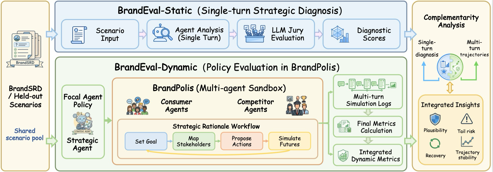

# BrandEval: A Two-Track Multi-Agent Benchmark for Risk-Sensitive LLM Crisis Communication

## EMNLP 2026 [Arxiv](https://arxiv.org/abs/2610.25208)
*Haotian Gan, Weidong Tang, Hanbin Sun, Yi Luo, Xintian Li, Jiayong Wang, WanYue Li, and Yudong Li*



## Abstract

Evaluating LLMs for crisis communication requires more than judging isolated responses, because public feedback and competitor actions can reshape trust over time. Existing benchmarks remain largely static and single-turn, offering limited evidence about long-horizon risk-sensitive communication. We introduce **BrandEval**, a two-track benchmark for product-crisis communication. BrandEval-Static evaluates stakeholder-aware strategic analysis, while BrandEval-Dynamic stress-tests response policies in **BrandPolis**, a controlled multi-agent sandbox with consumer feedback, competitor responses, and trust-risk trajectories. We also construct **BrandSRD**, a Chinese crisis-response dataset, and instantiate a reference Strategic Agent using Strategic Rationale (SR). Across proprietary and open-source models, we find that static strategic quality is informative but incomplete: it aligns with some end-state outcomes but does not reliably predict volatility and delayed recovery; dynamic stress tests further expose tail-risk failures under manipulative or weakly grounded policies.

## Repository Structure

```text
brandeval/                  BrandPolis simulator (import as `brandeval`)
  model.py                  market model: information exposure, BRI / NPS / SoV / Polarization, round records
  agents/                   consumer, brand (Strategic Rationale agent), brand_agent_ablation (w/o SR), competitor
  pipeline/                 round orchestration: t.1 strategic phase and evidence gate, t.2 diffusion
  config/                   hyperparameters, calibration, personas, scenario loaders
  evaluation/               trajectory metrics (ARV, CRS) and plots
  cli/run_sandbox.py        command-line entry point
  input/                    persona configuration
data/
  partial/static_scenario_descriptions_sanitized.jsonl   BrandEval-Static scenarios
  partial/preference_records_sanitized.jsonl             BrandSRD preference records
  partial_sandbox_scenarios.jsonl                        sandbox scenario examples
  population_templates.jsonl                             consumer population templates
  sandbox/background_sandbox.json                        background for the quick-start run
tests/                      pytest suite
requirements.txt
```

### Data Format

BrandEval-Static scenario:

```json
{
  "scenario_id": "static_0001",
  "description": "Crisis scenario description (Chinese)"
}
```

BrandSRD preference record:

```json
{
  "sample_id": "TRAIN_0001",
  "context_summary": "Crisis context",
  "superior_choice": {
    "action_text": "Published response",
    "strategic_rationale": "Why this response is preferred"
  },
  "suboptimal_choices": [
    {"action_text": "Alternative response", "strategic_rationale": "Rationale"},
    {"action_text": "Alternative response", "strategic_rationale": "Rationale"}
  ]
}
```

Consumer population template:

```json
{
  "agent_id": "template_perf_support",
  "agent_type": "consumer",
  "personality": {"driver": "性能导向", "initial_stance": "支持者"},
  "initial_influence_score": 1.0
}
```

## 🚀 Quick Start

### Prerequisites

```bash
pip install -r requirements.txt
export PYTHONPATH="$PWD"
```

### Basic Usage

Run a BrandPolis simulation offline (no model endpoint required):

```bash
BRANDEVAL_API_DISABLE_NETWORK=1 python -m brandeval.cli.run_sandbox \
  --background-file data/sandbox/background_sandbox.json \
  --steps 3 --num-consumers 6 --seed 7 \
  --output outputs/quick_start
```

This command will:
1. Build the consumer population over the 5 driver × 3 stance persona cells and fix the focal brand
2. Run, in every round, the strategic phase (brand action, evidence-consistency gate, competitor actions) and the diffusion phase (information exposure and consumer updates)
3. Record BRI, NPS, SoV, Polarization, and Backfire Rate per round
4. Save `metrics_record.json`, `agents_all.json`, `resolved_config.json`, and a trend plot

Runs with the same seed are deterministic. To drive the agents with a hosted model, set the endpoint and credential variables read by `brandeval.llm.interface`.

Useful options:

- `--brand-policy {sr,no_sr}`: Strategic Rationale agent (default) or the single-action ablation
- `--scenario-file data/partial/static_scenario_descriptions_sanitized.jsonl --scenario-index N`: run one Static scenario in the sandbox
- `--hyperparams-file`, `--calibration-file`, `--population-file`, `--persona-config-file`: override the simulation configuration

### Tests

```bash
python -m pytest -q tests
```

## Benchmark Tracks

### 1. BrandEval-Static
Stakeholder-aware strategic analysis on crisis scenario descriptions (`data/partial/static_scenario_descriptions_sanitized.jsonl`).

### 2. BrandEval-Dynamic
Response policies are stress-tested in BrandPolis with consumer feedback, competitor responses, and trust-risk trajectories. Round-level metrics: BRI, NPS, SoV, Polarization, Backfire Rate; trajectory metrics: ARV and CRS. In this release the impact of each official message is rated by an independent rater (see [MessageImpactRater](brandeval/pipeline/message_impact.py)) in place of the paper's fitted text-to-state regression, which is not included; sandbox results are therefore not comparable to the paper's dynamic-track tables.

### 3. BrandSRD and the Strategic Agent
BrandSRD pairs each crisis context with a superior strategy and two suboptimal strategies, each with a strategic rationale. The reference Strategic Agent (`brandeval/agents/brand_agent.py`) follows the Strategic Rationale workflow; `--brand-policy no_sr` runs the ablation without it.

## Citation

```bibtex
@misc{gan2026brandevaltwotrackmultiagentbenchmark,
      title={BrandEval: A Two-Track Multi-Agent Benchmark for Risk-Sensitive LLM Crisis Communication}, 
      author={Haotian Gan and Weidong Tang and Hanbin Sun and Yi Luo and Xintian Li and Jiayong Wang and WanYue Li and Yudong Li},
      year={2026},
      eprint={2610.25208},
      archivePrefix={arXiv},
      primaryClass={cs.AI},
      url={https://arxiv.org/abs/2610.25208}, 
}
```

## License

This project is released under the [Apache License 2.0](LICENSE).
